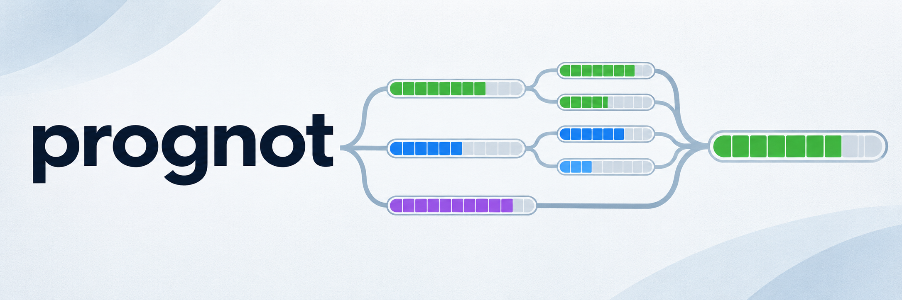
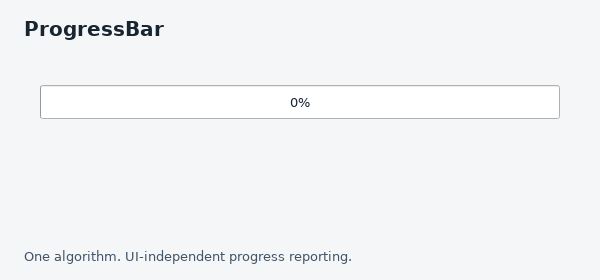
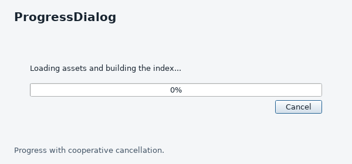
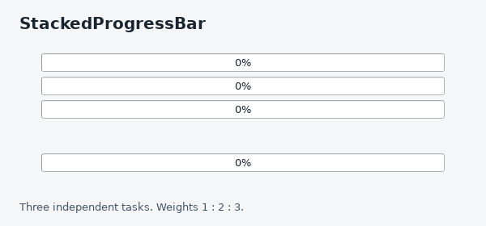

# prognot

[](https://github.com/JanKolomaznik/prognot/actions/workflows/core.yml)
[](https://github.com/JanKolomaznik/prognot/actions/workflows/qt.yml)
[](https://github.com/JanKolomaznik/prognot/actions/workflows/doxygen.yml)



**Composable progress reporting for C++20, with optional Qt 6 widgets.**

Give an algorithm a progress handle, split its work into weighted subtasks, and
report to a callback or a Qt widget. The algorithm stays independent of its UI.
The core is header-only; Qt is an optional compiled adapter.

## Why prognot?

- **Progress that composes.** A parent assigns a share of its work to a child;
  the child divides that share into its own steps without knowing the parent's scale.
- **Exact weighted totals.** Rational arithmetic with arbitrary-precision integers
  avoids cumulative rounding errors and overflow in deeply nested task weights.
- **Cooperative cancellation across the task tree.** Children share cancellation;
  C++20 stop tokens and sources connect reporting to the rest of your application.
- **Parallel work, ordered updates.** Independent task handles can report from
  separate threads; the core serializes callbacks and preserves progress order.
- **Useful lifecycle semantics.** Explicit completion and scope-based fallback,
  with distinct success, cancellation, failure, and abandonment outcomes.
- **A small integration surface.** Use a concept-constrained lambda for simple
  reporting or an observer for lifecycle events. Add Qt only when you need it.

## Quick start

```cpp
#include <prognot/prognot.hpp>
#include <iostream>

int main() {
    auto task = prognot::makeProgressNotifier([](const prognot::Progress& value) {
        std::cout << boost::rational_cast<double>(value) * 100 << "%\n";
        return true; // Return false to request cancellation.
    });

    task.setStepCount(10);
    task.increment(2); // 20%
    {
        auto loading = task.subTaskNotifier(3); // Reserve 30% of the whole job.
        loading.setStepCount(100);
        loading.increment(50); // Overall: 35%.
        loading.finish();      // Overall: 50%.
    }
    task.finish(); // Complete the remaining unallocated work: 100%.
}
```

Call `finish()` explicitly to observe callback exceptions. Normal scope exit also
completes a configured task's unallocated remainder; cancellation and exception
unwinding do not synthesize completion. Completing a parent never completes its
children's reserved work.

## Qt widget gallery

Short, looping captures of the actual Qt 6 widgets, using the Fusion style.
The same core progress handles drive all three; application algorithms do not
need Qt dependencies.

### ProgressBar

A single operation, from zero to completion. Updates reported by workers are
delivered on the GUI thread.



### ProgressDialog

A description, progress indicator, and Cancel button. Cancel, Escape, and window
close request cooperative cancellation; only a successful operation accepts the dialog.



### StackedProgressBar

Three independent operations with weights **1 : 2 : 3**. The popup shows each
operation; the lower bar shows their exact weighted mean. Completed tasks keep
their contribution until the group is cleared.



[Qt usage and threading rules](docs/qt.md) · [Regenerating the gallery](docs/gallery/README.md)

## Requirements and build

- C++20 compiler and standard library, including `std::stop_token`.
- CMake **3.28+**.
- Boost **1.85+**, with its CMake package installed; tested with **1.90**.
- Optional: Qt **6.5+** Widgets; tested with **6.10.2**.

The core uses Boost.Rational and Boost.Multiprecision headers. Unit tests use
Boost.Test's included runner, without a separate compiled test library.

```sh
cmake -S . -B build -DCMAKE_BUILD_TYPE=Debug
cmake --build build
ctest --test-dir build --output-on-failure
cmake --install build --prefix /your/install/prefix
```

Use `-DBUILD_TESTING=OFF` to omit tests. When several Boost versions are installed,
select one with `-DBoost_DIR=/path/to/lib/cmake/Boost-1.xx.0`. Dependencies are never
downloaded implicitly.

Consumers can use `add_subdirectory()` or the installed package:

```cmake
find_package(prognot 0.2 CONFIG REQUIRED)
target_link_libraries(my_app PRIVATE prognot::prognot)
```

The target propagates C++20, Boost headers, and the platform thread dependency.

### Build the Qt widgets and examples

```sh
cmake -S . -B build-qt -DPROGNOT_BUILD_QT=ON -DPROGNOT_BUILD_EXAMPLES=ON
cmake --build build-qt
ctest --test-dir build-qt --output-on-failure
```

Link **`prognot::qt`** for the adapter, bar, dialog, and stacked widget. Core-only
builds require no Qt installation. Qt tests run with the offscreen platform;
the examples use joined `std::jthread` workers and keep widget access on the GUI thread.

Each Qt adapter serves one operation. Create a handle with `makeNotifier()` on
the GUI thread and move it to a worker. See the [Qt integration guide](docs/qt.md)
for cancellation, widget lifetime, and aggregation rules.

## Continuous integration

GitHub Actions checks every push and pull request, with manual runs available:

- **Core:** build, test, and install without Qt, in Debug and Release.
- **Qt:** build the library and examples, test core and widgets offscreen, and
  install, in Debug and Release with Qt 6.8.3.
- **Doxygen:** generate the complete API reference with warnings treated as errors,
  then publish successful builds from `master` to GitHub Pages.

The badges above show the latest push results on `master`. Open a badge for run
logs; test reports and generated HTML are available as workflow artifacts for
14 days. CI uses Boost 1.90.0 and Doxygen 1.15.0.

The [online API reference](https://jankolomaznik.github.io/prognot/) is updated
from `master`; pull requests validate documentation without deploying it.
For the first deployment, select **GitHub Actions** under the repository's
**Settings → Pages → Build and deployment → Source**.

## Documentation

[Read the online API reference](https://jankolomaznik.github.io/prognot/).

- [Core API contract](docs/api.md): budgets, ownership, callbacks, cancellation,
  concurrency, iterator adaptation, and migration from the original API.
- [Qt integration](docs/qt.md): worker setup, signals, dialogs, and weighted groups.
- Doxygen comments cover the complete public core and Qt interfaces.

Generate the HTML API reference with Doxygen (verified with 1.15.0):

```sh
mkdir -p build
doxygen Doxyfile
```

Open `build/doxygen/html/index.html`. Documentation warnings are treated as errors.

## License

A project license has not yet been selected.
